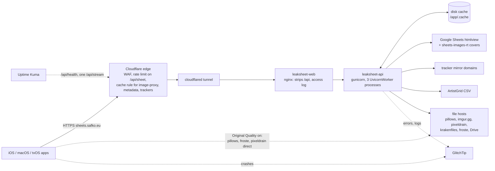

# Architecture

How the pieces of LeakSheet fit together and how a request moves through them. Commands
and the source layout are in [AGENTS.md](../AGENTS.md), endpoints in the
[README](../README.md#api), and the reasons behind non-obvious code in
[decisions.md](decisions.md) and [LeakSheet-iOS/DECISIONS.md](../LeakSheet-iOS/DECISIONS.md).

## Topology

| Component | Where it runs | Notes |
|---|---|---|
| Apps | `LeakSheet-iOS/` | One Xcode project; `Shared/` is compiled into all three targets. |
| Cloudflare | `safko.eu` zone | Only `/api/image-proxy`, `/api/metadata` and `/api/trackers` are edge-cached; `/sheet` is POST and `/stream` must not be cached. |
| cloudflared | Separate container on the host | Token-mode tunnel; ingress rules live in the Cloudflare dashboard. |
| nginx | `leaksheet-web` (`web/nginx.conf`) | No HTML; unknown paths 404. Logs `rt`, `urt` and the CF-Ray per request. |
| API | `leaksheet-api` (`Dockerfile`) | Runs as uid 1000. Workers recycle after ~1,000 requests. 6 GB memory cap. |
| Disk cache | bind mount `/DATA/AppData/leaksheet/cache` | Tab HTML, wire-ready JSON, covers, resized images, host health. Capped at 1 GiB. |
| GlitchTip, Dozzle | CasaOS apps (`ops/casaos/`) | Errors and log lines; container stdout on the LAN. |

Three gunicorn workers share nothing but the disk cache. Rate-limit counters, single-flight
parses and in-memory caches are per worker; host health and cache writes coordinate
through `flock`.

## `/sheet`: opening a tracker

1. The app's `TrackerLoader` POSTs the tracker URL with its cached ETag and asks for
   NDJSON progress. The app's own cache is used for a 304 and as a fallback on failure.
2. Cloudflare rate-limits `/api/sheet` per client. The API checks the host against the
   allowlist: built-in seed, ArtistGrid-listed hosts, and `LEAKSHEET_EXTRA_SHEET_HOSTS`.
3. The parsed cache decides the path:
   - **Fresh (under 1 h):** the stored bytes are served; a matching ETag gets a 304.
   - **Stale (1 h–7 days):** the stored bytes are served (a matching ETag still gets a 304);
     a background task revalidates, and drops the entry if the source is gone or private.
   - **Missing or older than 7 days:** a cold parse, while the client waits.
4. A cold parse runs once per worker per URL (single-flight). It fetches the htmlview page,
   discovers the tabs, and tries the Unreleased tab alone first. Then it fetches the
   secondary tabs (Art, Misc, badge tabs) concurrently, at most 6 at a time. Parsing runs
   in threads; a collapse guard refuses a result much smaller than the cached one. The
   HTML and the serialized bytes are written once; those bytes are the response.
5. Era covers download in a detached task after the response, because Google's cover
   URLs expire.

Measured on 2026-10-16: cold 1.6–12 s, almost all of it Google fetches; parse at most
1.5 s; warm hits 1–22 ms.

## `/stream`: playing a song

1. `StreamResolver` maps a sheet link to `/api/stream?url=…`. With Original Quality on,
   pillows, froste and pixeldrain play the host's download URL directly.
2. The API rejects hosts outside `ALLOWED_STREAM_HOSTS`, and answers 503 with
   `Retry-After` for a host marked down.
3. It resolves the link (host API call, page scrape, or Drive's download form). Every
   connection and redirect hop goes through the SSRF-guarded transport.
4. It forwards the client's Range header. It checks the first chunk's magic bytes to fix
   the Content-Type or refuse non-media, then streams 64 KiB chunks.
5. Failures feed host health, a JSON file under `flock`. One worker re-probes failing
   links every 60 s, and `GET /hosts` tells the app which hosts are down.

`/metadata` reports file details where the host exposes them (pillows, froste, imgur,
pixeldrain). `/image-proxy` resizes and caches covers from allowlisted image hosts.

## Deploy and operate

- **Deploy:** run `ops/deploy.sh` on the server. It resets the checkout to `origin/main`,
  builds both images, renders `ops/casaos/leaksheet.yml` with `~/LeakSheet/.env`, and
  restarts the CasaOS app. Never `docker compose up` in the checkout.
- **Timeouts:** gunicorn 90 s < nginx 120 s < Cloudflare 125 s, so a wedged worker is
  recycled before either proxy gives up.
- **Signals:**
  - Cold parses log a `sheet_timing` line and send a `Server-Timing` header.
  - The nginx line separates upstream time (`urt`) from client transfer (`rt`).
  - `ops/diag-upstream.sh` times DNS, TCP and TLS to Google from inside the container.
  - Uptime Kuma polls `/api/health` and one stream.
